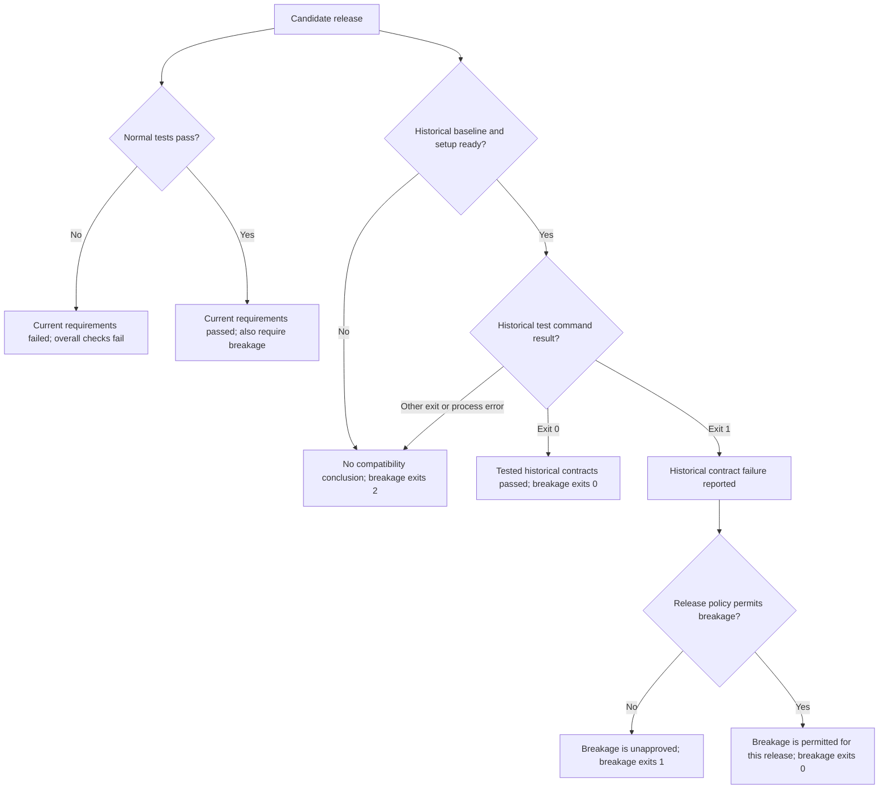

# breakage

Run yesterday’s tests against tomorrow’s release.

Command line tooling to detect breaking changes before you ship them.

## can i use breakage?

breakage is a tool for projects where

1. releases must follow semantic versioning
2. source code and tests are kept in separate files
3. new releases are associated to git tags
4. you can run tests from the command line

**if that sounds like your project, read on!**

breakage distinguishes two kinds of tests:

1. Public tests record behavior consumers can rely on across releases. breakage restores their released versions so a proposed change cannot weaken an assertion alongside the implementation it checks.
2. Private tests cover implementation details, development diagnostics, and other behavior you want to verify without preserving it as a release commitment. They can detect real bugs too; they are not used as the historical compatibility contract.

Identify the public tests with a glob pattern and provide a command that runs those tests once against source. The tested package's build and current-test preflight checks belong in independent jobs. Upstream dependency builds, such as Turbo's `^build`, can run before compatibility checks. Individual public contracts may build a disposable package or fixture when published entries, declaration files, or compiled runtimes are themselves the behavior being verified. A comparison without detected breakage means the selected released tests passed; its strength depends on the promises those tests actually protect.

## interpreting results

**Run normal tests alongside breakage, and require both checks to pass.** Normal tests check the candidate against its current requirements, including new public contracts and private implementation tests. breakage checks the candidate against the public contracts preserved in a previous release. Run them in independent jobs or checkouts so restoring historical tests does not interfere with the current suite. A passing breakage check never overrides failing normal tests, builds, or type checks.

Read the two branches below together; they describe independent checks, not an execution order. The breakage branch describes the public historical check after successful cleanup.



When normal tests pass but historical tests fail, the candidate satisfies the tested current requirements while failing an expectation encoded by the released suite. For example, removing an exported function and updating current callers can leave normal tests passing while a historical consumer test can no longer import that function. The import failure is evidence of a broken consumer contract even though no assertions execute. The point at which a test stops does not by itself distinguish incompatibility from a setup problem.

General misconfigurations that also affect the current suite surface in normal tests, even if release policy permits the historical failure. Failure to acquire a baseline, invalid configuration, and other setup errors leave the comparison inconclusive and fail the check. The test command's exit codes are a reporting convention, not an automatic diagnosis of the cause: exit 1 reports incompatibility; other nonzero exits or process errors report setup failure. See the [test command contract](#typescript-configuration-and-release-intent) when configuring your runner.

A successful check has two possible meanings: the selected historical tests passed, or they reported incompatibility that release policy permits. Permission to release a breaking change does not establish that compatibility was preserved. Passing historical tests establish only the promises those tests cover; normal tests remain independently required in either case.

## help

Run `breakage help` to show usage for the CLI, including the check options, `prelude`, and npm commands. The `help` command skips configuration discovery; it works without required check options and even when `breakage.config.ts` is malformed. It does not run checks.

Use `breakage help` instead of the former `--help` or `-h` options. Configuration no longer controls help. The empty route and an explicit `.ts` configuration path run checks.

## TypeScript configuration and release intent

Create `breakage.config.ts` with a default export. Public checks, `prelude`, and npm checks load this file by default; explicit `.ts` configuration paths still work. JSON configuration is no longer supported. Running TypeScript configuration on Node requires native erasable TypeScript support (Node 22.18 or newer). Information-producing hooks are functions, while tests and setup commands remain shell strings.

`defineConfig` and `satisfies BreakageConfig` check config keys and hook signatures while authoring. The same strict schemas validate loaded configuration, including nested release and npm options: misspelled keys fail setup instead of falling back to defaults. Comline awaits module initialization, validates the file before applying CLI overrides, and validates the merged result. Config modules and their imports may use top-level await to construct the default-exported config object. Initialization failures fail setup; Promise-valued default exports and config factories are not supported. Release inspection can remain inside `release.resolveDelta`, where the selected baseline and package context are available.

```ts
import { defineConfig, semverPolicy } from "breakage"
import { changesetsReleaseDelta } from "@breakage/changesets"

export default defineConfig({
	tagPattern: "refs/tags/my-library@",
	testPattern: "tests/public/**/*",
	test: "npm run test:public",
	release: {
		resolveDelta: changesetsReleaseDelta(),
		policy: semverPolicy({ beforeV1: "minor" }),
	},
})
```

`release.resolveDelta` is a synchronous/asynchronous function returning a `VersionTransition`: `{ previousVersion, version, delta }`, or `undefined` for no release evidence. The resolver receives `packageName`, `packageDirectory`, and `currentVersion`. Public checks also supply `baseline: { version, ref, commit }` from the exact commit selected for replay; npm support checks supply the historical manifest's baseline version. Omit `resolveDelta` to compare that baseline with the current manifest. For candidate identity checks without a historical baseline, the default comparison starts at the current manifest version.

For example, a pending Changesets minor release from `0.53.3` returns `{ previousVersion: "0.53.3", version: "0.54.0", delta: "minor" }`. After `changeset version` removes the changeset, the manifest's `0.54.0` supplies the same transition against the pinned `0.53.3` baseline. The resolver reports the transition; `release.policy` decides whether it permits breaking changes. A patch release to `0.53.4` does not permit a break with `beforeV1: "minor"`.

Breakage validates both versions, requires the target to be at least the current manifest version, checks `previousVersion` against any supplied baseline, and verifies that `delta` matches the actual semver difference. Invalid evidence and resolver errors fail setup. Release resolution happens before historical tests replace current tests. A resolver cannot override policy by returning a `breaking` field.

`semverPolicy()` permits major increments by default. `beforeV1: "minor"` additionally permits minor increments while the baseline major is zero; `beforeV1: "patch"` also permits patch increments there. A prerelease identifier change alone does not permit a break. At and after 1.0, the policy always requires a major increment. Equal and older versions never permit breaking changes.

Use `versionTransition(previousVersion, version)` to construct evidence without applying policy. Its `delta` is a semver release type or `"none"` for equal versions. `resolveReleaseDelta(release, context)` invokes and validates the resolver without applying policy. `versionDelta(previousVersion, version, policy?)` independently obtains `{ previousVersion, version, delta, breaking }`; a custom policy receives the transition and returns a boolean, and is called only for advancing versions.

A custom resolver can compose the plan reader with the transition helper:

```ts
import { defineConfig, semverPolicy, versionTransition } from "breakage"
import { readChangesetsReleasePlan } from "@breakage/changesets"

export default defineConfig({
	release: {
		resolveDelta: async ({
			packageName,
			packageDirectory,
			currentVersion,
			baseline,
		}) => {
			const plan = await readChangesetsReleasePlan(packageDirectory)
			return versionTransition(
				baseline?.version ?? currentVersion,
				plan.get(packageName) ?? currentVersion,
			)
		},
		policy: semverPolicy({ beforeV1: "minor" }),
	},
})
```

`test` is a nonempty shell-command string. Breakage runs it in the configured directory and captures stdout and stderr as diagnostics. Exit 0 succeeds, exit 1 reports incompatibility, and other nonzero exits or process failures report setup errors. A breaking release can permit incompatibility, but cannot permit setup errors. Runners using exit 1 for infrastructure failures need a wrapper that distinguishes those failures. Test functions are rejected; there is no implicit-success return convention. `testCommand` remains a string alias; configure only one.

`release.resolveDelta` and `release.policy` are functions whose return values carry transitions and policy decisions; stdout is never parsed as release information. `semverPolicy({ beforeV1: "minor" })` creates a policy function. If a resolver invokes an external program, it owns parsing and validating that program's output.

Comline treats `release` and `npm` as `configOnly` options. Their functions survive loading and validation without being called; they have no CLI flags or completion suggestions. Attempts to set them through flags, including dotted names such as `--release.policy`, fail setup. Ordinary scalar options retain their flags, aliases, and overrides.

Relative `baseDirname` values resolve from the configuration file's directory, which is also the default base directory when loading a config. CLI `--base-dir` values resolve from the caller's directory. CLI options override config fields, including `--test-command` overriding `test`. Test patterns, `baselineFile`, and prelude `out` are relative to the resulting base directory. Imports and additional filesystem work in callbacks should use `import.meta.url` or the supplied directory rather than assuming a process working directory.

Omitting `release` leaves detected breaks unapproved. Configure `release: { policy: semverPolicy({ beforeV1: "minor" }) }` to use a versioned manifest without a custom resolver. See [migration to the release model](#migration-to-the-release-model) for removed certification hooks and JSON configuration.

### Changesets integration

The separate [`@breakage/changesets`](../changesets/README.md) package provides two independent helpers: `readChangesetsReleasePlan(directory?)` returns a map of package names to planned versions, and `changesetsReleaseDelta({ directory? })` returns a release-delta resolver. The resolver discovers the workspace from each package directory unless given an explicit directory, reads a fresh plan, and compares its intended version (or the current manifest after versioning) with the supplied baseline. Without a baseline it compares against the current manifest, which supplies candidate identity without claiming a historical compatibility decision. The plan uses Changesets' own assembly logic, configuration, dependency propagation, and prerelease state. Errors reading the plan fail setup instead of silently falling back to the manifest.

Install the integration alongside Breakage. It owns its Changesets and workspace-discovery dependencies; no individual helper libraries need to be installed:

```sh
npm install --save-dev breakage @breakage/changesets
```

The core `breakage` package does not depend on the integration or its libraries. You can compose the plan reader with your own delta resolver or use the core release model with any other release process.

Migrating from `breakage/changesets`: install `@breakage/changesets` and change the import specifier. Both helper APIs are unchanged. Remove the old five optional peer installations if nothing else uses them. Keep `@changesets/cli` for your normal Changesets commands.

`defineConfig` shares a top-level `release` with `npm` checks unless `npm.release` is explicitly configured. Both workflows apply the same version comparison and policy to their own historical manifests. npm preparation, installation, and suite commands are shell strings; see the [npm guide](npm.md#shared-release-configuration).

## examples

### single-project repository

```bash
npx breakage \
  --tagPattern="refs/tags/my-library@" \
  --testPattern="tests/public/**/*" \
  --testCommand="npm run test:public"
```

Run this from the project root. It restores files matching `tests/public/**/*` from the newest matching `my-library@<version>` release tag and runs your project's `npm run test:public` command. Without `release` configuration, any detected break fails the check.

### multi-project monorepo

```bash
npx breakage \
  --tagPattern="refs/tags/my-library@" \
  --testPattern="packages/my-library/tests/public/**/*" \
  --testCommand="cd packages/my-library && npm run test:public"
```

Run this from the repository root. It restores the package's released public tests and runs its current public-test command. Patterns and commands are relative to the check's working directory; use `--baseDirname` if you want to run the check from a package directory instead.

In both examples, a failed test command requires a breaking release and makes the CLI exit nonzero. Inspect the failure to distinguish a consumer regression from a build, runner, or setup problem.

Release tags may use `1.2.3`, `v1.2.3`, `package@1.2.3`, or `@scope/package@1.2.3`, including valid prerelease and build identifiers. The newest matching version is selected by semantic-version precedence; tags without a supported version are ignored.

## caching compatibility checks

The ordinary `breakage` command discovers the newest release on `origin` each time it runs. Do not cache that whole command: a new release or a moved tag can change its baseline without changing any tracked checkout files.

For caching, run an uncached prelude that resolves and fetches the release, then cache the check with the generated snapshot as an input. Add `.breakage/` to your package's `.gitignore` first; the prelude requires a gitignored, untracked output path so the snapshot does not interfere with the clean-working-tree requirement.

```sh
breakage prelude --out .breakage/baseline.json
breakage --baseline-file .breakage/baseline.json
```

Both commands discover `breakage.config.ts` and accept the same `--tag-pattern` and `--base-dir` options. An explicit configuration path works as `breakage prelude ./custom.config.ts --out .breakage/baseline.json` and `breakage ./custom.config.ts --baseline-file .breakage/baseline.json`. The prelude does not require test or release options, and never runs tasks, resolves release versions, or builds the package. Existing full check configurations can be reused. Output and baseline-file paths are relative to `baseDirname`, which defaults to the configuration file's directory, or the current working directory without a config. The default prelude output is `.breakage/baseline.json`.

The versioned JSON snapshot contains the selected tag ref, its resolved commit SHA, the tag pattern, and the package directory relative to the repository root. Annotated tags are peeled to commits. Contents are deterministic and written atomically, with no timestamp or nonce. Fetching uses the SHA from discovery rather than a mutable tag name. An unchanged baseline produces identical snapshot bytes; a newer release or a moved tag targeting another commit changes them. A failed discovery, fetch, or write fails the prelude and removes an older snapshot at the validated output path.

The pinned check reads that locally available commit without contacting `origin` or discovering tags. A release published between prelude and check does not change this invocation's baseline. Missing, malformed, incompatible, or unavailable snapshots fail the check; rerun the prelude to refresh them. Each package or configuration needs its own snapshot path. Release resolution, test execution, Git locking, and restoration follow the same lifecycle as the ordinary command.

### Turbo

Add these scripts to the tested package, preserving your existing runner and release configuration:

```json
{
	"scripts": {
		"test:breakage:prelude": "breakage prelude --out .breakage/baseline.json",
		"test:breakage": "breakage --baseline-file .breakage/baseline.json"
	}
}
```

Use [Turbo's deferred hashing](https://turborepo.dev/docs/reference/configuration#deferred-hashing) so the snapshot is hashed after the uncached prelude completes. This configuration is exercised with Turbo 2.11.7:

```json
{
	"tasks": {
		"test:breakage:prelude": {
			"cache": false
		},
		"test:breakage": {
			"dependsOn": ["test:breakage:prelude", "^build"],
			"inputs": [
				"$TURBO_DEFAULT$",
				{ "mode": "jit", "globs": [".breakage/baseline.json"] }
			],
			"cache": true
		}
	}
}
```

Run `turbo run test:breakage` as usual. The prelude runs even when the compatibility check hits its cache; a failed prelude prevents the downstream task from replaying a cached success. Keep all additional runner, helper, configuration, environment, and release inputs in the compatibility task's hash, including release-plan files outside the package directory. Keep upstream `^build` prerequisites; the tested package does not need a self-build preflight. For runners without deferred hashing, finish the prelude before starting the task runner and include its snapshot in the check's cache key.

The JavaScript API exports `breakagePrelude({ out, tagPattern, baseDirname })` and accepts `baselineFile` in `breakage` options. Without `baselineFile`, the existing single-command discovery behavior is preserved.

## writing consumer contracts

Before preserving an assertion in a release, answer two questions: which consumer capability would its failure demonstrate is broken, and which harmless implementation changes should it continue to allow? A test named "public API" is not enough. Read every assertion as a promise you may need to keep after its original author and implementation have changed.

### choose the behavior deliberately

Test imports through the entrypoints consumers use. Resolve the tested package's consumer import names to source in the test runner so compatibility checks do not require its own build or freeze internal source paths. Upstream dependencies may use their built entrypoints. Check distributable output and declarations separately in the build and type-check jobs.

Write focused scenarios for the capabilities you want to support. Include combinations that make resource independence observable: two fonts or images on one page, multiple registrations, or two distinct handles. Exercising a method once does not establish that its effect survives serialization or that it works alongside another instance.

The exported object model can itself be public API. If consumers construct a document graph or inspect a returned dictionary, protect the promised identities, values, and relationships. Follow construction through to independently observed output; a correct JavaScript representation does not establish that the library writes it faithfully.

Private tests remain useful for implementation-specific assertions and visual baselines. An exact screenshot or historical byte sequence belongs in the public contract only when preserving that exact output is an intentional consumer promise. Same-run comparisons of repeated and equivalent inputs can protect determinism without requiring identical bytes across releases.

### make the expected result independent

Derive expected values from the scenario's requested behavior, documented semantics, or an independent observer. Comparing two paths through the current implementation allows both to become identically wrong.

For example, reading the output of both a document builder and a standalone serializer and comparing the results will not catch both producing a 1×1 page. Assert the requested dimensions directly. Check document identifiers, font selection, text origins, and binary values when those are part of the scenario.

Choose inputs that make omissions visible. Request a nondefault stroke color; black cannot distinguish a working setter from a missing setter when black is already the default. To test visual regression detection, compare documents with different painted content but identical geometry and rendering options. Changing a background option may change a manifest and report a mismatch even if pixel comparison is disabled. Require meaningful page differences as well as the failure result.

Use malformed descriptions to exercise rejection by the exported validator and serializer, not just checks in a higher-level builder. A reader successfully opening a document may also conceal a serialization defect if it repairs malformed structures. Verify the relevant structural property independently when validity is part of the promise.

### avoid accidental commitments

Keep setup inline and specific to each scenario, or use a narrowly named helper that explains exactly what it constructs. A generic shared "example document" can make unrelated tests depend on arbitrary page shapes and metadata. Include any fixture or helper that determines historical expectations in the restore pattern.

Preserve outcomes at the point consumers need them. If invalid input only needs to be rejected before serialization succeeds, encompass construction and serialization in the throwing assertion. Requiring rejection at a particular intermediate call is a stronger promise; make it only deliberately.

Inspect helpers for constraints too. A baseline-preservation helper should collect files recursively rather than assume the artifact directory is flat. A decoder should accept equivalent encodings rather than require the current serializer's spacing, dictionary order, or hexadecimal capitalization. Allow generated resource names and allocation order to vary unless consumers actually depend on them.

### preserve the observation code

Released assertions need trustworthy readers. If today's writer and today's observation helper can change together, an unchanged historical assertion can still become weaker. Include the helper's source in `testPattern` when its behavior determines the meaning of those assertions.

Mondrian publishes its independent inspection tools through its testing entrypoint and restores their source alongside the public tests:

```ts
export default {
	tagPattern: "refs/tags/mondrian\\.pdf@",
	testPattern: "{tests/public,src/testing/inspection}/**/*",
	testCommand: "pnpm test:public",
}
```

This illustrates the restore boundary; `test:public` is a project-provided command that only runs its public suite against source. Consumer type checks and builds have separate commands. Omitting `release` keeps detected breaks unapproved.

Match the assertions and observation code, and leave the implementation they are meant to evaluate outside that boundary. When an observer also ships as a library feature, its restored implementation is trusted test infrastructure for this comparison; verify its current implementation separately too. Execute observation source directly after restoration so historical readers run without a build.

breakage restores matched Git files, not installed dependencies. A shared package manifest and workspace lockfile keep setup simple, but dependency upgrades must keep restored readers runnable. If a reader needs its own dependency versions, include that dependency description in the restore boundary and make your test command install it. Merely matching a lockfile does not perform an installation. Protect runner configuration and other support files when they determine how historical assertions execute.

### check that the tests can fail for the right reason

Before releasing the suite, deliberately introduce representative regressions in a disposable checkout. Run the public command against each mutation and inspect the failure, then restore the checkout. Require the intended assertion or consumer-import/type check to fail; an unrelated build, setup, or test failure proves nothing about that contract.

| Mutation                                          | Contract that should detect it                           |
| ------------------------------------------------- | -------------------------------------------------------- |
| Remove an exported function or declaration        | Consumer imports and type checking                       |
| Ignore a requested position, color, or identifier | Independent expected output values                       |
| Give distinct resources the same generated name   | Multiple distinguishable resources used together         |
| Return success for every validation request       | Malformed input requiring diagnostics and rejection      |
| Disable page-difference detection                 | Changed painted content with identical rendering options |
| Drop byte-keyed entries during serialization      | Independently decoded names and values                   |

Test the other direction too: harmless refactors should pass. Try moving an internal source entrypoint while preserving package exports, rejecting invalid input earlier or later within the promised boundary, nesting artifact files, or switching between equivalent encodings. This exposes accidental commitments before they become historical requirements.

Also verify the restoration mechanism once: change a current observation helper so the public command fails, commit the probe in a disposable checkout, and compare against a known release containing the original helper. Check that the historical helper is restored and used, and that the original working copy returns afterward. Use a local-only release for experiments rather than publishing a probe tag.

### run current contracts and historical contracts

Run the current suite in a parallel test job so newly added contracts are checked independently. Let the CLI run only the released suite against source through `testCommand`. Configure the command to fail when it selects no tests and avoid cached test results that can bypass execution of restored files. Builds and type checks have separate commands and jobs. Tests should run once and terminate.

Run the check from a clean checkout with access to `origin` and release tags. An initial release without matched public tests provides no baseline: preserve the CLI's inconclusive result until a release includes them. A missing baseline is not evidence of compatibility.

When the job fails, identify the phase before deciding on a breaking release. A failed current test, incompatible runner types, a build problem, a missing baseline, and a released assertion detecting a consumer regression require different responses. A breaking version delta permits a released contract failure (exit 1); setup errors (other nonzero exits or thrown errors) remain failures. A breaking release acknowledges changed consumer behavior rather than establishing compatibility.

### case study: mondrian.pdf

[Mondrian's adoption PR](https://github.com/jeremybanka/mondrian/pull/108) separated consumer contracts from implementation tests and exact visual proofs. Independent reviews introduced mutations that still passed the proposed public suite, including ignored positions and identifiers, collapsed resources, and disabled visual differences. Strengthening the corresponding scenarios made those regressions observable. Refactor probes also removed unintended commitments to rejection timing and flat artifact directories.

An October 5, 2026 audit examined 237 subsequent Breakage jobs: 186 passed, 48 failed, and 3 were cancelled. Of the failures, 13 were the initial missing-release-baseline result; the other 35 stopped in current-suite type checking with mismatched Vitest dependencies before historical comparison ran. After the baseline was established, the default branch had 64 passing checks and no failing checks. No failed job in that audit was traced to an arbitrary PDF expectation. See the [workflow history](https://github.com/jeremybanka/mondrian/actions/workflows/test.yml), a [baseline failure](https://github.com/jeremybanka/mondrian/actions/runs/35064496994/job/104691685448), and a [runner-alignment failure](https://github.com/jeremybanka/mondrian/actions/runs/36281497246/job/108514056194).

The contracts continued to pass through [PDFium changes](https://github.com/jeremybanka/mondrian/actions/runs/35280593318/job/105401343541) and an [aligned Vite Plus upgrade](https://github.com/jeremybanka/mondrian/actions/runs/36543626809/job/109324668309). That is evidence for the chosen boundaries over the audited changes, not a claim that the suite covers every possible consumer regression.

## git environment

breakage uses simple-git v4, which filters inherited `GIT_*` environment variables and certain other Git-related variables, including `SSH_ASKPASS`, from its Git subprocesses. Environment-based settings such as `GIT_SSH_COMMAND`, `GIT_ASKPASS`, and `GIT_CONFIG_*` no longer configure tag discovery, fetching, or file restoration. Configure authentication and Git behavior through Git configuration files, SSH configuration, or an SSH agent instead. This filtering applies to breakage's Git operations; test tasks still inherit the normal process environment.

## parallel checks and file restoration

Checks with disjoint public test paths can run their test tasks in parallel, in their original working directories. breakage coordinates Git setup and cleanup with a short-lived lock and records each running check's test paths. The clean-repository check ignores only the paths owned by active checks; unrelated uncommitted changes still prevent a new check from starting. Checks with overlapping test paths are rejected before replacing files. Remote tag discovery runs outside this lock, and fetches use a separate lock in the common Git directory. Cleanup waits for file-restoration access instead of giving up when a setup timeout expires.

Released tests are loaded with `git restore --worktree`. After testing, including failures, breakage restores only those paths to their starting commit and removes tests that existed only in the release. The Git index and existing stashes are preserved. Unrelated files, command outputs, and changes made by other packages are left in place. There is no repository or dependency copy. Commands that themselves modify shared files or Git state still need their own coordination.

If a process is forcibly interrupted or restoration fails, breakage retains recovery information under `breakage/` in the worktree's Git directory (`git rev-parse --absolute-git-dir`). After confirming the process has stopped, restore each recorded path from the recorded `head` commit, remove any recorded paths absent from that commit, and remove the record. An interrupted setup or cleanup can also leave the `breakage/lock` directory; remove it only after confirming no setup or cleanup is still running. An interrupted fetch can leave `breakage-fetch.lock` in the common Git directory; remove it only after confirming no fetch is still running.

## options

The optional [`breakage npm` command family](./npm.md) checks peer compatibility and end-of-support changes for npm packages. Its representatives and packed candidates apply only to that namespace; the release model is shared with public checks. For distributed matrices, [`npm plan`, `npm execute`, and `npm verify`](./npm.md#ci-and-caching) provide coverage audits, a shared archive bundle, and complete execution receipt verification. Configure discovery and archive preparation through `npmMatrix` in TypeScript. The ordinary public check retains the adoption conditions and behavior described above. Both commands can use `breakage.config.ts`; default discovery uses it, and an explicit `.ts` configuration path wins. TypeScript configuration uses the runtime's native support for erasable TypeScript.

| Check option     | Shorthand | Required           | Purpose                                           |
| ---------------- | --------- | ------------------ | ------------------------------------------------- |
| `--tagPattern`   | `-g`      |                    | RegExp selecting release tags.                    |
| `--testPattern`  | `-p`      | Yes                | Glob selecting released public tests and helpers. |
| `--testCommand`  | `-t`      | Either task option | Shell alias for `test`.                           |
| `--test`         |           | Either task option | Command running the restored public contracts.    |
| `--baseDirname`  | `-d`      |                    | Working directory for Git and commands.           |
| `--baselineFile` |           |                    | Prelude snapshot pinning the release commit.      |
| `--verbose`      | `-v`      |                    | Print timing information for the check.           |

`prelude --out` sets its gitignored snapshot path. Run `breakage help` for the full option descriptions and examples.

## cli completion

With `breakage` installed on PATH, run `breakage completion install bash` to install Bash completion. Replace `bash` with `zsh`, `fish`, `nushell`, or `carapace` for the other supported integrations. Installation uses the shell's existing completion setup and does not edit shell profiles; open a new shell afterward. `breakage completion bash` prints the integration for manual installation. See [Comline's shell setup requirements](https://github.com/jeremybanka/wayforge/tree/main/packages/comline#shell-integrations).

Completion suggests commands, option names, config file paths, snapshot paths for `--baseline-file` and `prelude --out`, and directories for `--base-dir`. It works without a valid config file or required option values and does not run checks. Singleton options disappear from suggestions after use; parsing behavior is unchanged.

## cli option aliases and warnings

These aliases work alongside the original option names. Removed certification options fail with migration guidance.

| Original option  | Aliases                        |
| ---------------- | ------------------------------ |
| `--tagPattern`   | `--tag-pattern`                |
| `--testPattern`  | `--test-pattern`, `--pattern`  |
| `--testCommand`  | `--test-command`               |
| `--baseDirname`  | `--base-dir`, `--base-dirname` |
| `--baselineFile` | `--baseline-file`              |

After successful parsing, breakage warns on stderr about unknown options and options that do not apply to the selected command. Warnings appear before check output is captured and do not change the command's exit status.

## migrating from break-check

Breakage continues [break-check](https://github.com/jeremybanka/wayforge/tree/break-check%400.8.1/packages/break-check) in its own repository. Install `breakage`, replace the `break-check` command with `breakage`, and convert `break-check.config.json` to a default export in `breakage.config.ts`. The original rename preserved configuration keys and outcomes; the release-model migration below applies when upgrading to this breaking minor release. Reinstall shell completions with `breakage completion install <shell>`.

For programmatic use, import `breakage`, `BreakageOptions`, and `BreakageOutcome` from `breakage` in place of `breakCheck`, `BreakCheckOptions`, and `BreakCheckOutcome` from `break-check`.

Finish active break-check runs and recover any interrupted runs before switching. Breakage stores new recovery records under `breakage/` in the worktree's Git directory and its fetch lock at `breakage-fetch.lock` in the common Git directory.

## Migration to the release model

This is a breaking minor release before 1.0. Configuration is TypeScript-only; shell-command strings and the `testCommand` alias remain supported. There is one task executor and one release decision model.

- Remove `certifyCommand` and its CLI flags (`--certifyCommand`, `--certify-command`, `-c`). Configure `release.resolveDelta` and `release.policy` instead. Removed hooks fail explicitly.
- Replace npm `releaseIntent` with `release.resolveDelta`. Return `{ previousVersion, version, delta }` or `undefined`, rather than `{ status: "release", version }` or `{ status: "none" }`. Throw when inspection fails.
- Replace npm `certifyBreaking` with `release.policy`. Use `semverPolicy({ beforeV1: "minor" })` for this pre-1.0 convention, or a function receiving `{ previousVersion, version, delta }`. Support findings remain in the npm report; the policy receives version evidence only.
- Replace the removed `ReleaseIntent`, `ReleaseContext`, and `ReleaseEvidence` types with `ReleaseDeltaResolver`, `ReleaseDeltaContext`, `VersionTransition`, and `VersionDelta` as appropriate.
- Public outcomes expose `release?: VersionDelta`; use `outcome.release?.breaking` to check release approval. `breakingChangesCertified`, `certificationStdout`, and `certificationStderr` are removed. npm support status `certified` becomes `breaking-release`, with the full version delta in `support.release`.
- Tests, npm setup, and npm suite commands must be shell strings. Exit 0 succeeds, 1 detects incompatibility for tests, and other nonzero statuses or process errors fail setup. Release intent never approves setup errors. `test` and `testCommand` cannot both be configured.
- Convert JSON configuration to `breakage.config.ts` with a default export. JSON config, JSON schema generation, and the `--release` JSON flag are removed. Express `release.resolveDelta` as a function returning a transition, using `versionTransition(previousVersion, version)` if helpful, and `release.policy` as a function or `semverPolicy(...)`.
- Relative config directories now resolve from the config file. Check filesystem paths when migrating configurations previously loaded from another working directory.
